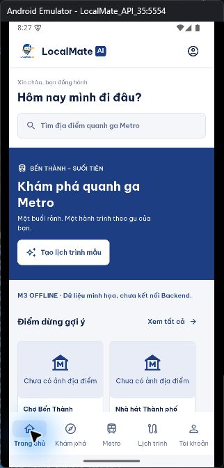
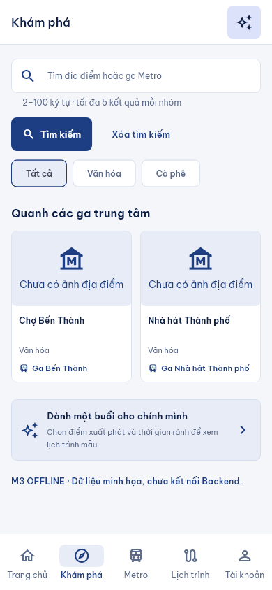
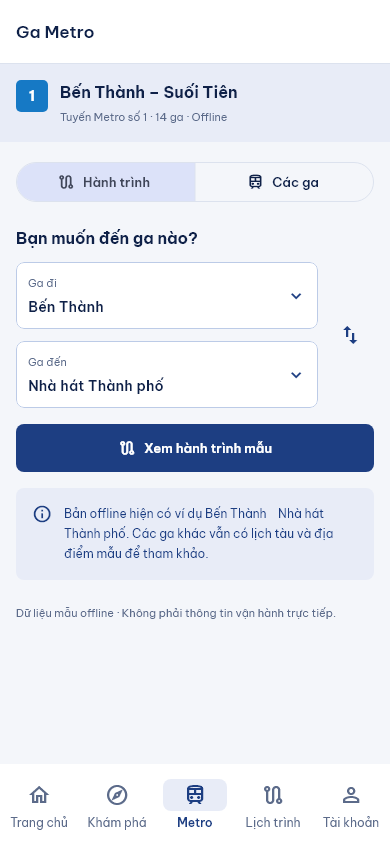
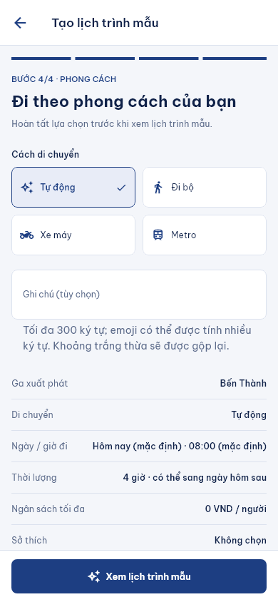
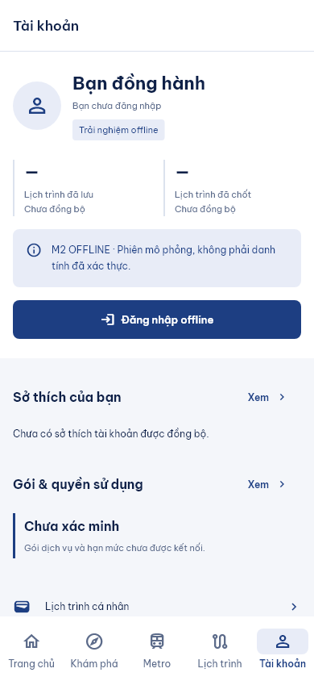

# UI v0.2 — tiến trình 24/10/2026

## Nguồn làm việc

- Repo: CharlieMinh/LocalMate_AI_Mobile; thư mục `Mobile/LocalMate_AI_Mobile_canonical`.
- Nhánh: `feature/v02-visual-alignment`, HEAD đầu lượt `1374c9a`.
- Thiết kế gốc: `../../index.html`; bộ ảnh: `../../outputs/mobile-v02-rendered-reference-20261022/`.
- Worktree đã có nhiều thay đổi của chủ dự án trước khi bắt đầu. Không reset, ghi đè toàn bộ file hoặc coi toàn bộ diff là thay đổi của agent.
- Chủ dự án đã kiểm tra và chấp thuận UI ngày 24/10/2026, yêu cầu commit/push và tạo PR vào `main`.

## Ảnh tiêu biểu trong repository

Ảnh Home chụp emulator Android. Các ảnh còn lại là render widget với fixture tại 390×844/chữ 100%; không phải bằng chứng pixel parity với HTML. Bộ ảnh đầy đủ và log là artifact cục bộ; các đường dẫn `../../outputs/` bên dưới được tính từ thư mục gốc repository trong workspace EXE201.

| Home Android | Explore | Metro |
|---|---|---|
|  |  |  |

| Planner bước 4 | Tài khoản |
|---|---|
|  |  |

## Đã hoàn thành lượt 23/10

- Giữ các chỉnh sửa Home, Explore, Metro, Planner và tài khoản có sẵn.
- Sửa header: Home giữ logo; Explore/Metro/Trips/Account dùng tiêu đề cố định, bỏ tiêu đề lặp trong nội dung. Đưa CTA tạo lịch trình lên AppBar.
- Thêm thống kê tài khoản chưa đồng bộ; đưa đăng nhập lên vùng danh tính.
- Cá nhân hóa và gói dịch vụ mở thành trang riêng; bổ sung vùng giá chưa tải.
- Cập nhật các kiểm thử cũ theo UI mới, giữ kiểm tra hành vi/session/validation; thêm 6 ca điều hướng tài khoản tại 320/390/768 và text 100%/200%.
- Thêm cấu hình VS Code và query `screen`, `width`, `scale` cho preview development.
- `flutter analyze --no-pub`: sạch. `flutter test --no-pub`: 280 pass. `git diff --check`: sạch.
- Bằng chứng: `build/ui-review-final-2.log`, `../../outputs/mobile-ui-review-20261023/explore.png`, `place-detail.png`.
- Chưa commit/push; chưa kiểm tra APK mới trên Android trong lượt này.

## Hoàn thiện giao diện ngày 24/10

- Khởi động lại VS Code workspace, preview cổng 5211 và emulator LocalMate_API_35.
- Thêm công cụ `tool/ui_capture_test.dart` để render các route, bốn bước Planner, preview và màn tài khoản tại nhiều kích thước.
- Planner bước 4 dùng thẻ phương tiện có icon và trạng thái chọn; bảng tóm tắt có ga đích tùy chọn và phương tiện. Giữ nguyên enum/DTO gửi đi.
- Thêm màn chuẩn bị hành trình riêng với tiến trình và trạng thái offline; giữ cơ chế Back/hủy kết quả cũ.
- Việt hóa Material date/time picker, tooltip điều hướng; hiển thị ngày dạng dd/MM/yyyy và ngân sách có dấu phân nhóm trong tóm tắt/preview.
- Sửa logo trang đăng nhập xuống dòng ở 320dp/chữ 200%; chỉ giới hạn scale của cụm thương hiệu, nội dung vẫn theo cỡ chữ hệ thống.
- Gói dịch vụ chuyển nhãn giá xuống dòng khi chữ lớn, tránh ép tên gói thành cột hẹp.
- Font nhãn chuyển tab Metro thống nhất Be Vietnam Pro.
- Helper ghi chú Planner tự tăng chiều cao, tránh cắt hướng dẫn ở 200%.
- Bổ sung `android:enableOnBackInvokedCallback="true"` trong manifest sau khi phát hiện cảnh báo Android 15; APK đã build/cài lại, merged manifest có flag. Cấu hình theo [hướng dẫn Flutter](https://docs.flutter.dev/platform-integration/android/predictive-back).

## Phạm vi đã rà soát

| Nhóm | Kết quả giao diện | Điểm khác có chủ đích / còn chờ |
|---|---|---|
| Home | Lời chào/tìm kiếm trên nền trắng, hero tràn ngang, CTA trong hero, card gợi ý và lối vào Metro/lịch trình | Hero nền navy và media placeholder; dữ liệu fixture khác prototype |
| Explore | Header/CTA, bộ lọc ngang, lưới hai cột, kết quả theo nhóm, empty/retry | Giữ nút gửi tìm kiếm và giới hạn hợp đồng; không đổi sang tìm kiếm place-only |
| Địa điểm / lịch trình mẫu | Media, thông tin phân cấp, CTA cố định, timeline điểm dừng | Không thêm rating, giá hoặc khoảng cách thiếu trong DTO |
| Metro / chi tiết ga | Bộ chọn ga có tìm kiếm, đổi hướng, hành trình mẫu, danh sách 14 ga, thông tin hai hướng và giãn cách | Không rút dữ liệu còn vài ga như HTML; lịch mẫu có nhãn hiệu lực |
| Planner 1–4 | Progress, thẻ thời lượng/sở thích/phương tiện, helper, summary, nút cố định | Không thêm field phong cách vào Generate khi chưa có hợp đồng; ngày nhập vẫn ISO để validation, picker và summary Việt hóa |
| Loading / preview | Màn chờ riêng, metadata, timeline đánh số, điều chỉnh lại | Chỉ bản mẫu tạm; không có server Trip ID, quota hoặc xác nhận đã lưu/chốt |
| Tài khoản / đăng nhập | Danh tính, CTA đăng nhập, thống kê chưa đồng bộ, menu và biểu mẫu | Giữ thông báo offline; không dùng số liệu/quota giả |
| Cá nhân hóa / gói / trips | Trang riêng có Back, bố cục sở thích/gói, trạng thái rỗng và CTA | Persistence, giá/quyền lợi, mua gói và trips thật là phần tích hợp tiếp theo |
| Maps | Bottom sheet xem liên kết và giải thích offline | Không mở dịch vụ bên ngoài trong lượt rà soát |

## Kiểm chứng

- Toàn bộ suite: **281/281 pass**, đã chạy lại trước khi đóng gói PR (`build/ui-pr-final-tests.log`; kết quả lượt rà soát trước: `build/ui-review-20261024-final.log`).
- `flutter analyze --no-pub`: không có issue.
- Công cụ render cuối: **3/3 pass**, 30 ảnh cho mỗi cấu hình: 390×844 chữ 100%, 320×844 chữ 200%, 768×844 chữ 100%. Bổ sung Maps sheet, danh mục Explore rỗng và phần dưới preview (`build/ui-overlay-captures-20261024.log`).
- Các widget test hiện có còn kiểm tra 320/390/768 ở chữ 100% và 200%, bàn phím mô phỏng, Back, validation, session fences và vòng đời tác vụ.
- APK debug đã build thành công (`build/ui-apk-final.log`). Có cảnh báo công cụ Android SDK XML v3/v4; build không thất bại.
- Sau hai chỉnh sửa cuối (helper ghi chú và định dạng ngày trong summary): analyze sạch; **29/29** kiểm thử Planner + render đạt (`build/ui-finishing-20261024.log`); `flutter run` đã build/cài APK mới và mở thành công trên emulator API 35.
- Đã quan sát Home, các bước Planner, cuộn vùng ngân sách và nút Back trong AppBar trên Android thực tế. Emulator dùng bàn phím máy tính nên chưa xác nhận trực quan bàn phím ảo; kiểm tra viewInsets/bàn phím trong suite là mô phỏng widget.
- **Back hệ thống Android đã kiểm chứng sau sửa và khởi động lại emulator:** từ bước 2 gửi `KEYCODE_BACK` → trở về bước 1; gửi Back từ bước 1 → Home. Kiểm tra bằng Android UI Automator và ảnh cửa sổ emulator. XML trước/sau nằm trong `native/planner-before-back.xml`, `native/planner-after-back.xml`, `native/home-after-back.xml`; ảnh `native/planner-after-back.png`. Nút AppBar Back cũng đã hoạt động. Đây là kiểm tra hành vi thực trên API 35, ngoài widget test.
- Ảnh render cuối đã xem bổ sung: Maps sheet tại 320dp/chữ 200%, Explore danh mục rỗng và phần dưới preview; không có overflow trong các ca render.
- Môi trường emulator có override kích thước 780×1688/density 320 trên phần cứng 320×640/density 160. Sau lần cài lại, cửa sổ hiển thị wallpaper dù Flutter Inspector và UI Automator vẫn trả cây Home. Reset override về mặc định và khởi động lại emulator đã khôi phục hiển thị/chạm. Lượt chạy cuối dùng **Impeller mặc định**; renderer dự phòng chỉ dùng thử qua CLI, không thêm cờ tắt Impeller vào manifest sản phẩm. Ảnh `native/home-default.png` thể hiện cấu hình mặc định sau khôi phục.
- Ảnh từ `tool/ui_capture_test.dart` là render widget với fixture; không phải ảnh emulator hay golden test chứng minh khớp pixel. Bằng chứng Android thực tế lưu riêng trong thư mục `native` của báo cáo.
- `PAIRED_PIXEL_VERIFICATION = NOT_VERIFIED`: chưa chuẩn hóa viewport/DPR/crop HTML để đo đồng trạng thái; không báo phần trăm giống nhau.
- Chưa kiểm thử trên thiết bị iOS hoặc điện thoại Android vật lý.

## Mở lại và tiếp tục

- VS Code: mở đúng `Mobile/LocalMate_AI_Mobile_canonical`, chọn cấu hình `LocalMate · Android` hoặc `LocalMate · UI preview`.
- Android: `flutter emulators --launch LocalMate_API_35`, sau đó `flutter run --no-pub -d emulator-5554 -t lib/main.dart`.
- Web review: `flutter run --no-pub -d web-server --web-port 5211 -t lib/dev/android_preview_main.dart`.
- Preview: `http://localhost:5211/?screen=/home&width=390`; có thể đổi `screen`, `width`, `scale=2`. Đây là canvas hỗ trợ review, không thay thế emulator.
- Render lại ảnh: `flutter test tool/ui_capture_test.dart --no-pub`.
- Báo cáo ảnh: `../../outputs/mobile-ui-review-20261024/index.html`. Bản render mới nằm trong ba thư mục theo kích thước; ảnh HTML tham chiếu được liên kết từ bộ gốc.
- Đợt UI đã được chủ dự án kiểm tra/chấp thuận và đóng gói trên nhánh `feature/v02-visual-alignment` để tạo PR vào `main`. Tổng diff gồm cả chỉnh sửa có sẵn của chủ dự án, lượt 23/10 và lượt 24/10; trạng thái bàn giao commit/PR được ghi trong lịch sử Git và PR tương ứng.
- Bước tiếp theo nên xử lý theo thứ tự: tài nguyên ảnh được phép sử dụng; chốt hợp đồng Backend/Auth/Generate; tích hợp dữ liệu thật và các luồng Save/Finalize/entitlement. Không coi bản giao diện offline là đã hoàn tất các milestone tích hợp.

## Giới hạn cần phân biệt với giao diện

- Ảnh địa điểm vẫn dùng placeholder; bộ ảnh tham chiếu ghi chưa được đưa ảnh du lịch vào public repo. Không tuyên bố đạt pixel parity.
- Danh mục fixture khác prototype; giữ đủ 14 ga và nhóm kết quả Ga/Địa điểm/Lịch trình.
- Save/Finalize, quyền sử dụng, thanh toán, OAuth và hồ sơ đồng bộ chưa được tích hợp. Không thêm kết quả thành công giả hoặc số liệu tài khoản giả để lấp chỗ trống.
- Quy cách ngày/giờ Việt Nam, ngân sách mỗi người, sở thích optional, 1–24 giờ và qua đêm vẫn là hợp đồng phải giữ.
